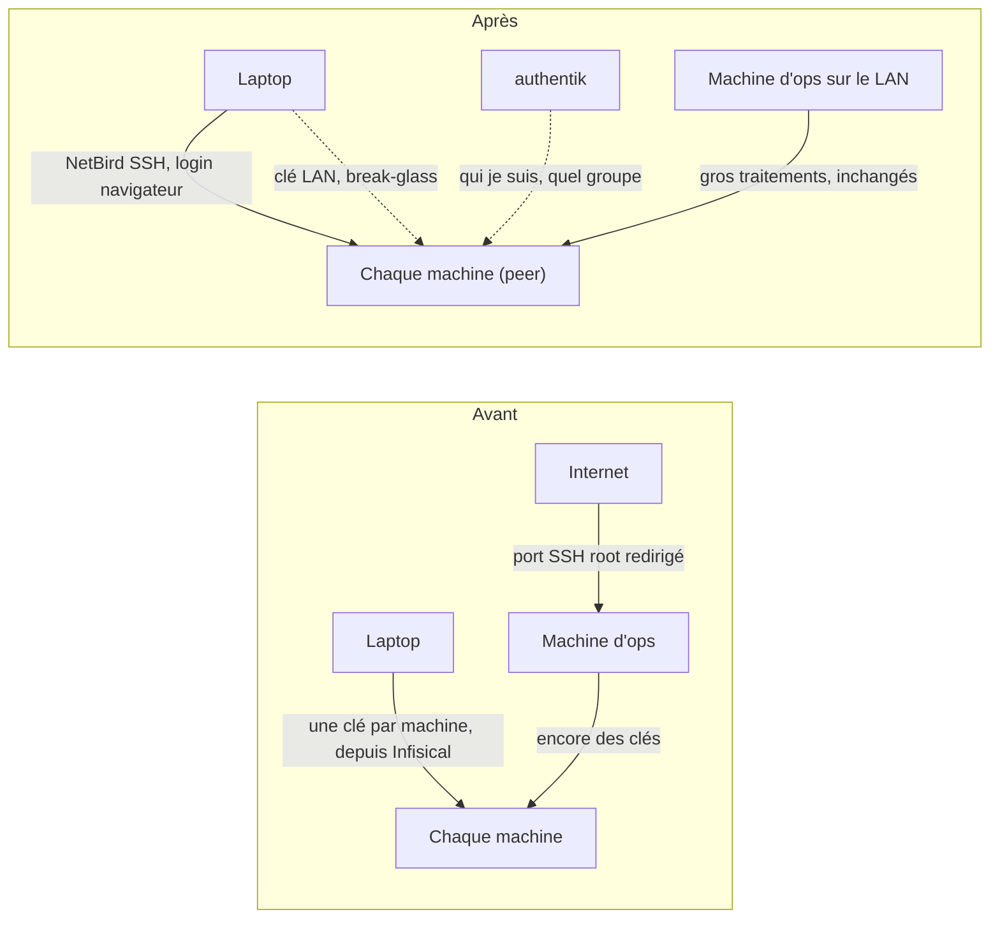
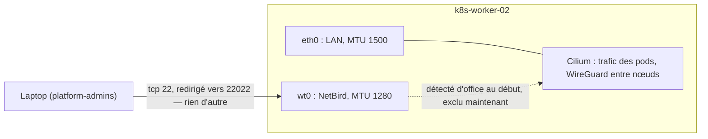
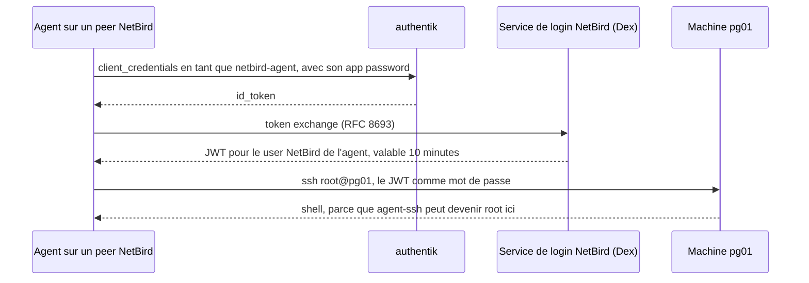

## Introduction

Cet après-midi, j'ai voulu me connecter au témoin etcd, une petite VM dont le seul rôle est de garder honnête le quorum de mon cluster Postgres. La clé qu'utilisent les playbooks Postgres a été refusée. Celle des VMs Kubernetes aussi. Celle qui a marché, c'était une troisième, `id_pg_etcd_witness`, que Terraform avait générée pour cette seule machine il y a des mois et dont j'avais oublié l'existence.

Tout le problème tient dans cette machine. Mon `~/.ssh` contient une clé par serveur : une pour les VMs Kubernetes, une pour le témoin, une pour le build runner, une pour le conteneur de stockage, une pour le serveur NFS, une pour la machine d'ops, une pour le Raspberry Pi. Celles qui ne sont pas sur mon laptop sont dans Infisical, et chaque playbook qui y touche commence par écrire une clé dans un fichier temporaire, puis passe `-e ansible_ssh_private_key_file=` en ligne de commande. Le matin même, une session de debug était restée bloquée un bon moment, simplement pour trouver un moyen d'entrer sur un des hôtes Proxmox.

La solution évidente, c'est de mieux gérer les clés : une seule clé partout, une autorité de certification à courte durée, un script qui va chercher la bonne. Chacune de ces options garde l'erreur de fond : _la clé est l'identité_. Celui qui a le fichier, c'est moi, sur cette machine, tant que le fichier existe.

J'ai plutôt déplacé l'identité là où je la maintiens déjà. Chaque session SSH vers une machine commence maintenant par un login dans le navigateur, sur authentik, l'identity provider que le reste du cluster utilise déjà, et la machine décide quel utilisateur je peux devenir selon le groupe auquel j'appartiens. Pour moi, il n'y a pas de nouveau secret à stocker, parce qu'il n'y a pas de clé.

## La décision qu'il a d'abord fallu revoir

Quand j'ai reconstruit ce cluster, j'ai écrit ce que je ne ferais pas, et une de ces décisions disait : pas de Wireguard ni de Tailscale. Un VPN mesh comme porte d'entrée du cluster, c'était à l'époque une pièce mobile dont je n'avais pas besoin.

Ce que je voulais maintenant, c'était justement un mesh. NetBird, que je venais de déployer pour relier deux laptops et un Raspberry Pi, embarque un serveur SSH dans son client. Le client authentifie chaque connexion avec un token issu du même login que celui du dashboard, et associe des groupes à des utilisateurs locaux. Ça ne marche que si les machines elles-mêmes rejoignent le mesh.

Il fallait donc revenir sur ce « non », et le plus utile a été d'écrire à quel point on y revenait peu. Les machines deviennent des peers pour SSH, et rien d'autre. Pas de route vers le LAN, pas d'exit node, pas de pod sur le mesh, pas de trafic Kubernetes dessus. Les inventaires Kubernetes et Postgres pointent toujours sur les adresses du LAN et ne changent pas. Les gros traitements — une mise à jour complète de Kubernetes, une reconfiguration de Postgres, tout ce qui redémarre un nœud — partent toujours de la machine d'ops, sur le LAN : un mesh qui tombe en plein changement etcd, c'est une bien pire journée qu'un login un peu lent.

Les anciennes clés restent. Sur le LAN, elles sont la porte de secours si NetBird ou authentik tombe. Depuis l'extérieur, une fois le cutover fait, une seule clé break-glass sera acceptée, via la machine d'ops. Le nouveau chemin n'a pas le droit d'être le seul tant qu'il n'a pas échoué au moins une fois devant moi.

## Une configuration que je peux aussi cliquer

Les réglages de NetBird vivent dans sa base de données, pas dans un fichier que je peux committer : groupes, policies, setup keys, quel peer peut faire du SSH vers où. Je les voulais dans git, sans pour autant renoncer au dashboard, qui reste le moyen le plus rapide de voir ce que le mesh croit être vrai.

Ces deux envies se battent, sauf si l'une des deux sait qu'elle n'est pas aux commandes. Le playbook qui déclare le compte via l'API REST de NetBird a deux modes. Par défaut, il ne fait que _créer_ ce qui manque ; pour tout le reste, il compare et signale : « cette policy diffère du fichier, laissée telle quelle ». Ce n'est qu'avec un `-e netbird_enforce=true` explicite qu'il réécrit ses propres valeurs, et seulement sur les champs qu'il nomme. Ce qu'il ne nomme pas, il ne l'écrit jamais. Un changement fait dans le dashboard tient jusqu'à ce que je décide que le fichier doit gagner, et le run suivant me le signale.

Ce partage a servi dans l'heure. Pour avoir accès pendant que je déboguais, j'avais ajouté le groupe des machines à mon propre utilisateur dans le dashboard. NetBird propage les groupes d'un utilisateur à ses appareils : mon laptop est donc discrètement devenu une « machine d'infra », et le run suivant en mode enforce a activé son serveur SSH, puisque c'est ce que le playbook fait aux machines d'infra. Sans conséquence — la seule machine autorisée à s'y connecter était le laptop lui-même — mais la leçon est claire : appartenir au groupe ne prouve pas qu'on est une machine. Les machines s'enrôlent avec une setup key et n'appartiennent à aucun utilisateur. Le playbook n'agit plus que sur celles-là, et signale comme drift tout appareil d'un utilisateur qui se retrouve dans le groupe des machines.

## Le check qui ne me voyait pas

Le premier design avait un contrôle de plus : un posture check qui n'autorisait un laptop à joindre les machines que s'il était géolocalisé en France. Il ne coûtait rien à ajouter et ressemblait à un second mur bon marché.

Au premier test depuis chez moi, mon laptop ne voyait aucune machine. Le serveur NetBird juge la localisation d'après l'adresse d'où vient la connexion, et chez moi, mon laptop joint le serveur — qui tourne dans mon propre cluster — via le NAT hairpin de la box. Pour le serveur, j'étais `192.168.1.254`, la box elle-même, sans aucun pays. Le check ne pouvait jamais passer depuis l'endroit où je m'en sers le plus.

Aucune correction ne gardait le check honnête. Une seconde policy autorisant mon sous-réseau aurait laissé entrer n'importe qui sur n'importe quel réseau en `192.168.1.0/24`, l'un des réglages par défaut les plus courants des box. Le check géographique a donc disparu, et l'accès repose sur ce qui faisait déjà le vrai travail : un login par session, et l'appartenance au groupe des admins. C'est exactement le rôle du spike. Mieux vaut découvrir un contrôle aveugle sur trois machines de test que dans un train.

## Ce que le déploiement a attrapé

Les trois premières machines étaient un spike, et il a encore servi deux fois avant que quoi que ce soit d'autre ne rejoigne le mesh.

La règle SSH que j'avais écrite n'avait pas de port, parce que le protocole SSH de NetBird semblait en impliquer un. Ce n'est pas le cas. Sur le worker, le firewall généré par NetBird disait `ip saddr <laptop> accept` : tous les ports TCP de la machine, ouverts à mon laptop via le mesh. Une ligne — `ports: ["22"]` — et la règle n'autorise plus que 22 et le 22022 vers lequel il est redirigé.

L'autre était plus discret. Cilium, la couche réseau du cluster, détecte les interfaces tout seul, et il a aussi pris celle de NetBird. Son MTU est de 1280, donc Cilium a réduit son propre tunnel en conséquence — sur ce seul nœud. Les petits paquets passaient ; c'est exactement le genre d'écart qui fait bloquer les gros et ressemble à un bug applicatif des semaines plus tard. Fixer Cilium sur l'interface du LAN, avant qu'un autre nœud Kubernetes ne rejoigne le mesh, a remis le nœud au niveau des autres.

Le mesh sert à SSH et à rien d'autre, et les deux corrections sont cette phrase rendue concrète : un seul port en entrée, et aucun trafic du cluster sur l'interface du mesh.

## L'agent aussi doit se connecter

Un login dans le navigateur, ça me va. Pour un agent, c'est rédhibitoire. Je fais une bonne partie de ce travail avec un assistant IA qui lance des commandes depuis mon laptop, et sa première tentative via le mesh s'est bloquée sur `Connection timed out during banner exchange` : le client NetBird attendait que quelqu'un valide une page de login.

Les deux réponses évidentes sacrifient quelque chose. NetBird a des service users avec des clés d'API, mais son serveur SSH ne les accepte pas : il ne prend qu'un token à courte durée émis par son propre service de login, et son code exclut explicitement les service users de l'accès SSH. Désactiver l'authentification SSH sur les machines aurait marché pour l'agent, et supprimé au passage la vérification de mon identité.

Ce qui a marché, c'est d'appliquer la même idée à l'agent : lui donner son propre login, pas une clé. C'est un service account dans authentik, avec un app password. Un petit script l'échange contre un token authentik, l'échange à son tour auprès du service de login de NetBird contre le token qu'attend le serveur SSH, et s'en sert comme mot de passe SSH. Ce token vaut dix minutes.

L'agent détient donc un secret, contrairement à moi. La différence avec une clé, c'est où il vit et comment il meurt : un seul identifiant, à un seul endroit, qu'authentik peut révoquer sans toucher une seule machine.

L'agent joint maintenant n'importe quelle machine avec `node.sh pg01 <commande>`, sous le même nom que la machine porte partout ailleurs — j'ai passé une partie de ce déploiement à faire en sorte que chaque machine ait exactement un nom dans Proxmox, Kubernetes, Ansible, Pi-hole et NetBird.

Une chose utile si vous faites la même chose : quand authentik refuse un app password, il répond `invalid_grant` et ne logue rien. Ici, la cause était un retour à la ligne que la CLI de secrets ajoute à sa sortie.

## Où on en est

Quatorze machines sont sur le mesh : les trois hôtes Proxmox, les cinq nœuds Kubernetes, les deux serveurs Postgres et le témoin etcd, le build runner, la machine d'ops et le Pi-hole. L'enrôlement est un playbook, étape par étape, et les nœuds du control plane comme les membres Postgres sont passés un par un, le réplica avant le leader. Rien n'a bronché : le cluster est resté sain, Patroni n'a jamais changé de leader, Proxmox a gardé son quorum.

`ssh root@pg01` m'ouvre un onglet de navigateur et me pose sur la machine. Pour l'agent, `node.sh pg01` fait la même chose sans navigateur.

Pas encore fait, et pas revendiqué : deux machines de stockage qui attendent une fenêtre de maintenance, un conteneur sans clé SSH pour démarrer, ce qui arrive aux sessions ouvertes quand le serveur NetBird redémarre, et le cutover qui réduira les anciennes clés au rôle de break-glass. Les clés sont toujours sur mon laptop. Ni l'agent ni moi n'en avons besoin pour travailler.
