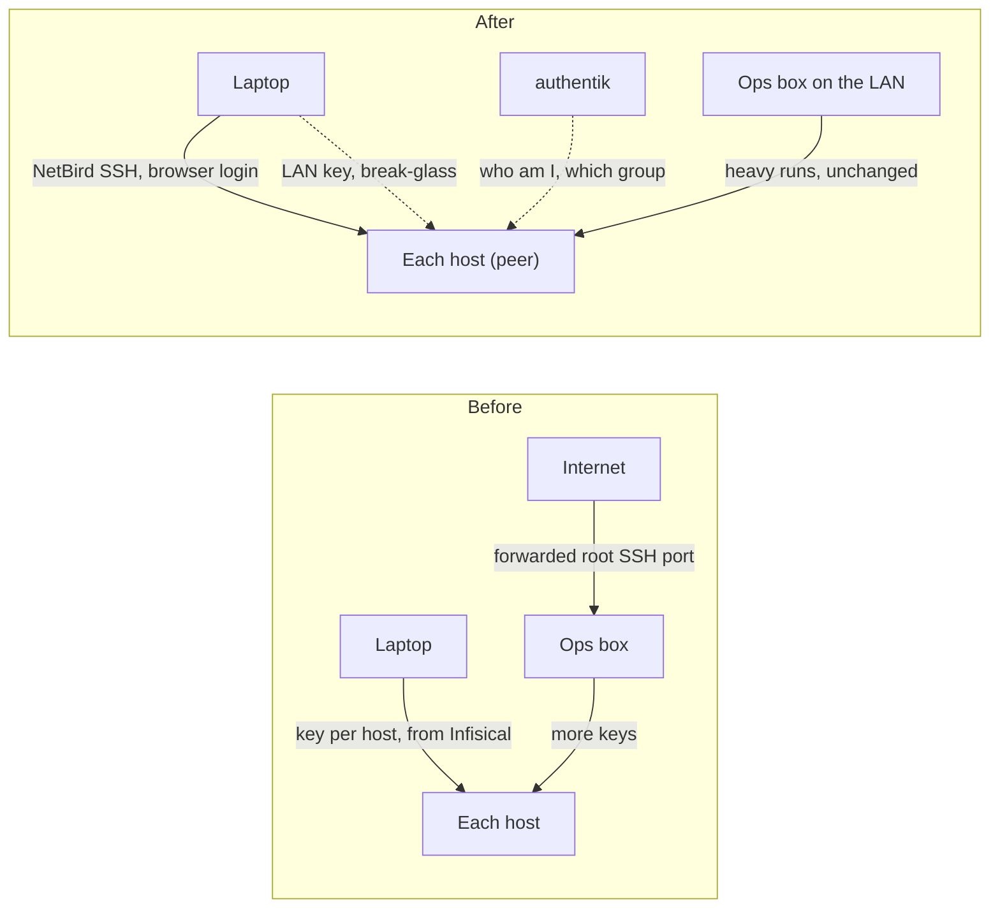

## Introduction

This afternoon I tried to log into the etcd witness, a small VM whose only job is to keep my Postgres cluster's quorum honest. The key the Postgres playbooks use was refused. So was the Kubernetes VMs' key. The one that worked was a third, `id_pg_etcd_witness`, which Terraform had generated for that one machine months ago and which I had forgotten existed.

That is the whole problem in one host. My `~/.ssh` holds a key per box: one for the Kubernetes VMs, one for the witness, one each for the build runner, the storage container, the NFS server, the ops hub, the Raspberry Pi. The ones that don't live on my laptop live in Infisical, and every playbook that touches them starts with fetching a key to a temp file and passing `-e ansible_ssh_private_key_file=` on the command line. Earlier the same day, a debugging session had stalled for a while on nothing more than finding a way into one of the Proxmox hosts.

The obvious fix is to manage the keys better: one key everywhere, a short-lived certificate authority, a script that fetches the right one. Each of those keeps the actual mistake, which is that _the key is the identity_. Whoever holds the file is me, on that host, for as long as the file exists.

What I did instead was move the identity somewhere I already maintain it. Every SSH session to a host now starts with a browser login against authentik, the identity provider the rest of my cluster already uses, and the host decides who I may become based on the group I'm in. There is no new secret to store, because there is no key.

## The decision I had to reverse first

When I rebuilt this cluster I wrote down what I would not do, and one of those records said: no Wireguard or Tailscale. A mesh VPN as the way into the cluster was, at the time, a moving part I didn't need.

What I wanted now was exactly a mesh. NetBird, which I had just deployed to connect two laptops and a Raspberry Pi, has an SSH server built into its client. The client authenticates each connection with a token from the same login I use for the dashboard, and maps groups to local users. That only works if the hosts themselves join the mesh.

So the old "no" had to be reversed, and the useful part of reversing it was writing down how little it reverses. The hosts become peers for SSH and nothing else. No route into the LAN, no exit node, no pod on the mesh, no Kubernetes traffic over it. The Kubernetes and Postgres inventories still point at LAN addresses and never change. The heavy runs — a full Kubernetes upgrade, a Postgres reconfigure, anything that reboots a node — still run from the ops box on the LAN, because a mesh that drops in the middle of an etcd change is a much worse day than a slow login.

The old keys stay. On the LAN they are the way back in if NetBird or authentik is down; from outside, once the cutover lands, only a single break-glass key will be accepted, through the ops box. Nothing about the new path is allowed to be the only path until it has failed in front of me at least once.

## Configuration I can also click

NetBird's settings live in its database, not in a file I can commit: groups, policies, setup keys, which peer may SSH where. I wanted those in git, and I also didn't want to give up the dashboard, which is the fastest way to see what the mesh thinks is true.

Those two wants fight unless one of them is told it is not in charge. The playbook that declares the account through NetBird's REST API runs in two modes. By default it only _creates_ what is missing, and for everything else it compares and reports: "this policy differs from the file, left as is". Only with an explicit `-e netbird_enforce=true` does it write its own values back, and then only on the fields it names. Anything it doesn't name, it never writes. A change made in the dashboard survives until I decide the file should win, and the next run tells me it exists.

That split earned its keep within the hour. To get access while I was debugging, I had added the hosts' group to my own user in the dashboard. NetBird propagates a user's groups to that user's devices, so my laptop quietly became an "infra host", and the next enforce run switched on its SSH server, because that is what the playbook does to infra hosts. Nothing came of it — the only machine allowed to connect was the laptop itself — but the lesson was clear: group membership is not proof of being a host. Hosts enroll with a setup key and belong to no user. The playbook now only acts on those, and reports any user-owned device that turns up in the hosts' group as drift.

## The check that could not see me

The first design had one more control: a posture check that only let a laptop reach the hosts if it geolocated to France. It cost nothing to add and looked like a cheap second wall.

The first time I tested from home, my laptop could not see a single host. The NetBird server judges location by the address a connection comes from, and at home my laptop reaches the server — which runs inside my own cluster — through the router's hairpin NAT. To the server I was `192.168.1.254`, the router itself, with no country at all. The check could never pass from the one place I use it most.

There was no fix that kept the check honest. A second policy allowing my home subnet would have let in anyone on any network numbered `192.168.1.0/24`, one of the most common defaults a home router ships with. So the geo check is gone, and access rests on what was already doing the real work: a login per session, and membership of the admins group. That is the spike doing its job. It is cheaper to find a blind control on three test hosts than on a train.

## Where it stands

Three hosts are enrolled: the etcd witness, one Kubernetes worker, and the build runner, a container that needed `/dev/net/tun` passed through from its Proxmox host before the client would start. Enrollment is itself a playbook — package repository, a pinned client version held against unattended upgrades, `netbird up` with a setup key read from a file and deleted after — because the point of all this was to stop doing things to hosts by hand.

`ssh root@k8s-worker-02.bnei.mesh` opens a browser tab, I log in, and I'm on the box. No key file, nothing fetched first.

Not done yet, and not claimed: Ansible over the mesh, and how many browser prompts a playbook run actually costs; what happens to open sessions when the NetBird server restarts; the rest of the hosts, enrolled in stages with the Postgres leader and the storage boxes last; and the cutover that finally narrows the old keys to break-glass. The keys are still on my laptop. For the first time, I don't need them to get to work.
